# 报告配图索引

录屏图片均为直接解码的完整原始帧，未裁剪或改写读数；相对时间从录屏起点计算。现场照片为原图复制。

## 500kSPS，24路，30组/包，READY

源录屏 00:40。

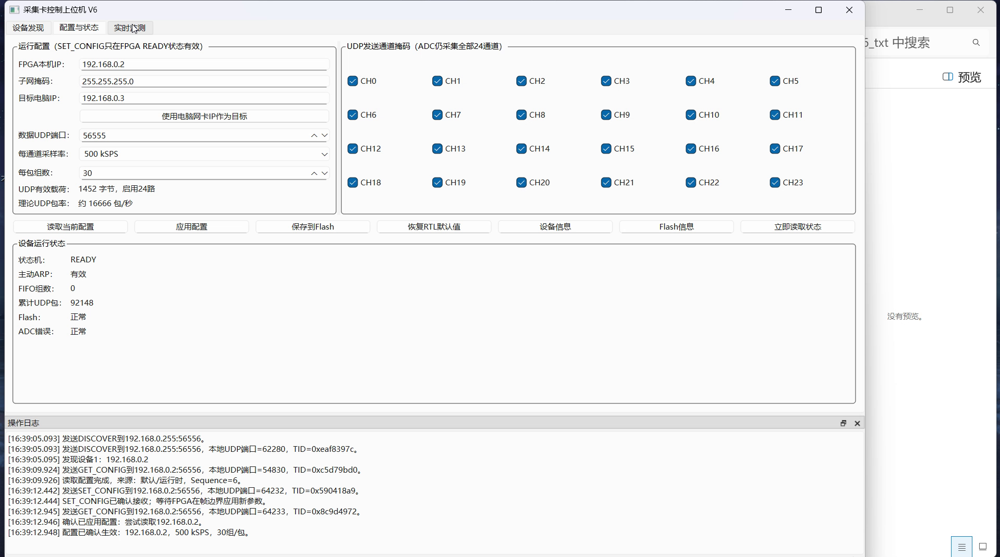

## 500kSPS运行；当前放大CH00～03，四路周期波形清晰

源录屏 02:16。

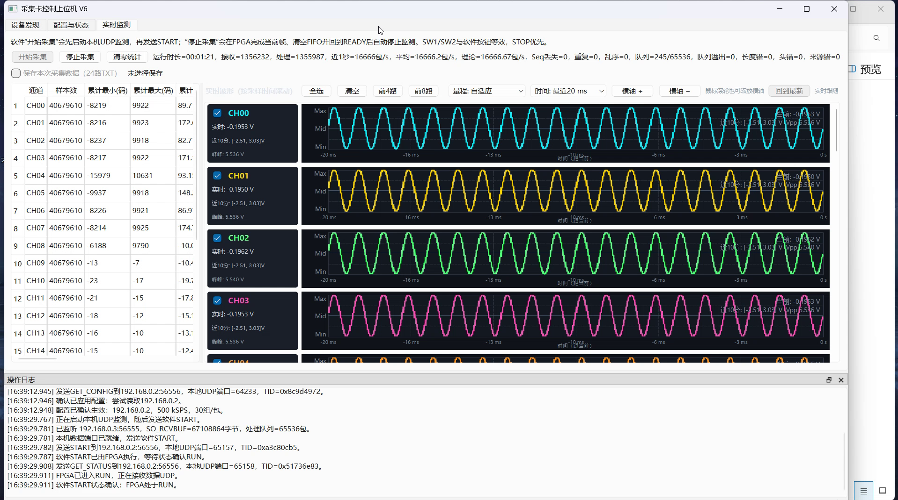

## 250kSPS配置页，READY

源录屏 03:55。

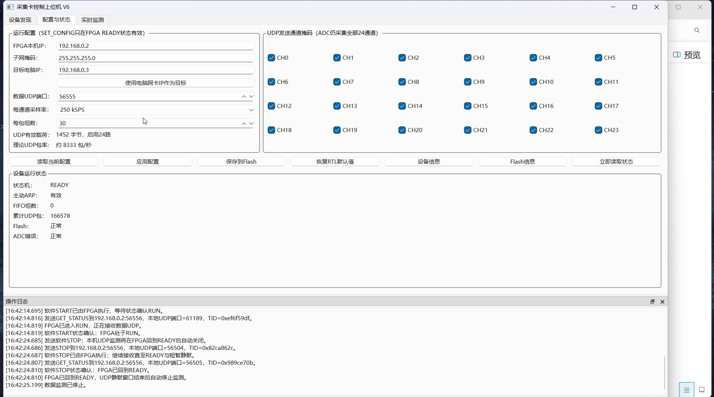

## 250kSPS运行及计数

源录屏 04:10。

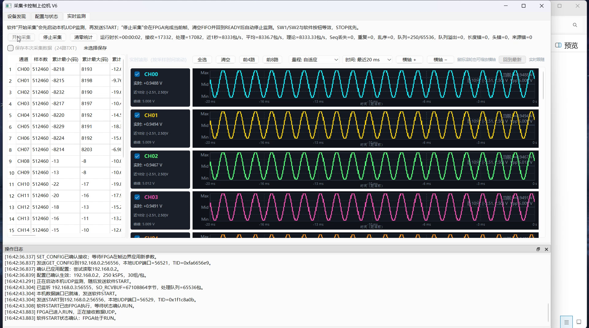

## 1MSPS短时运行片段，不能单凭此帧声称持续稳定

源录屏 04:40。

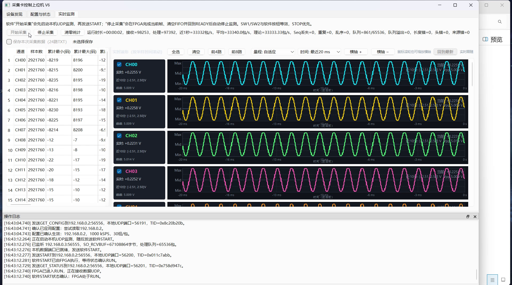

## 保存成功；500kSPS，22路上传，28组/包，Sequence=7

源录屏 08:00。

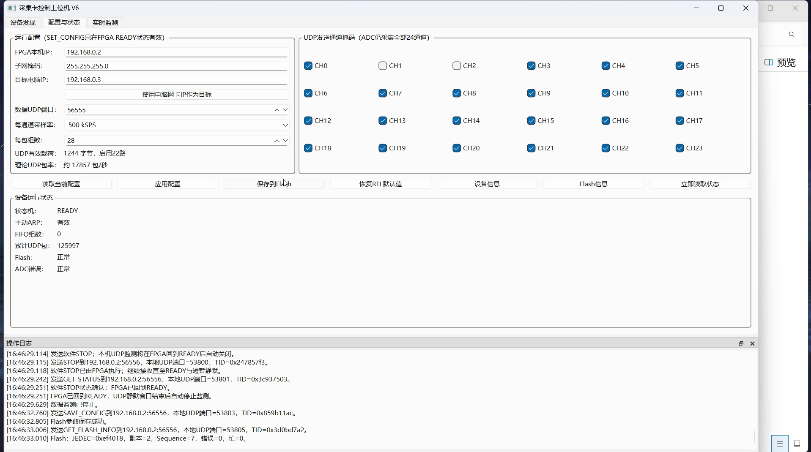

## 读回来源Flash，Sequence=7，500kSPS/22路/28组

源录屏 08:30。

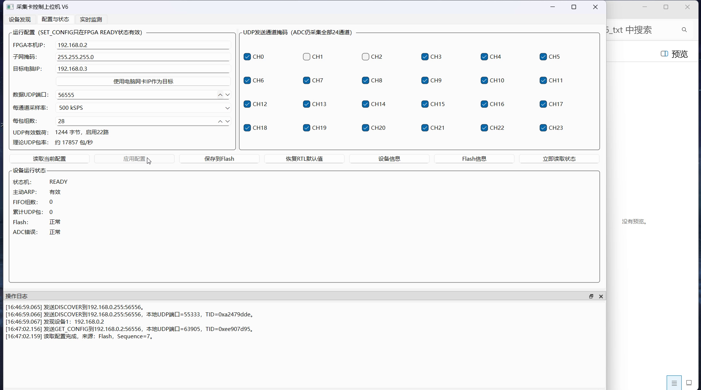

## 后续恢复24路/500kSPS/30组配置

源录屏 10:05。

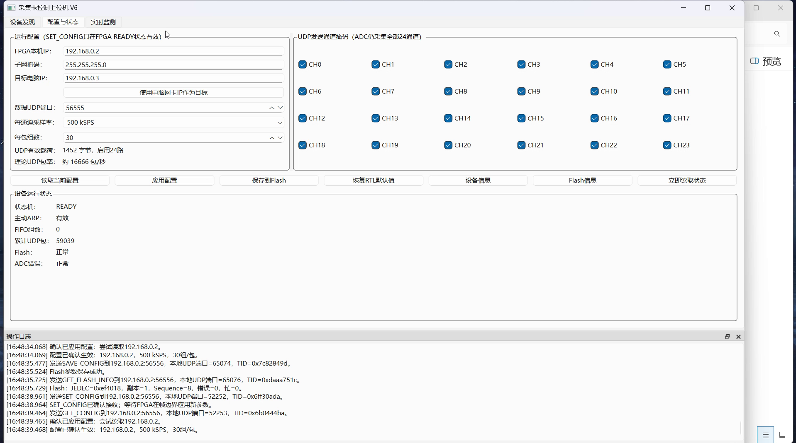

## 当前可见CH13～15正弦，CH16未接信号

源录屏 11:45。

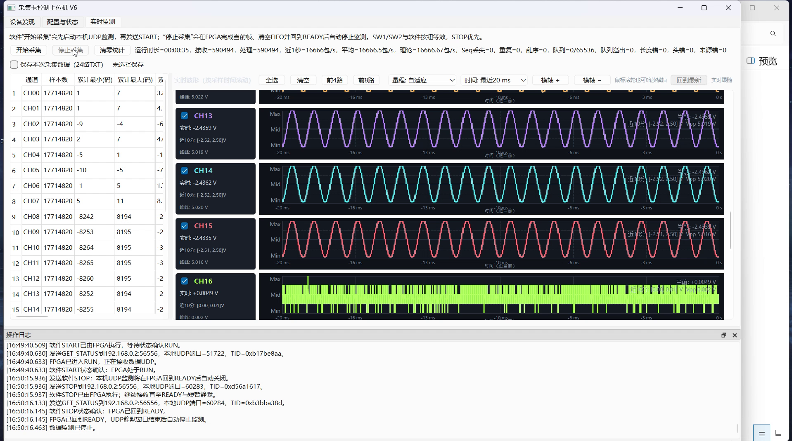

## 当前可见CH18～21正弦，需其他视角覆盖其余通道

源录屏 12:25。

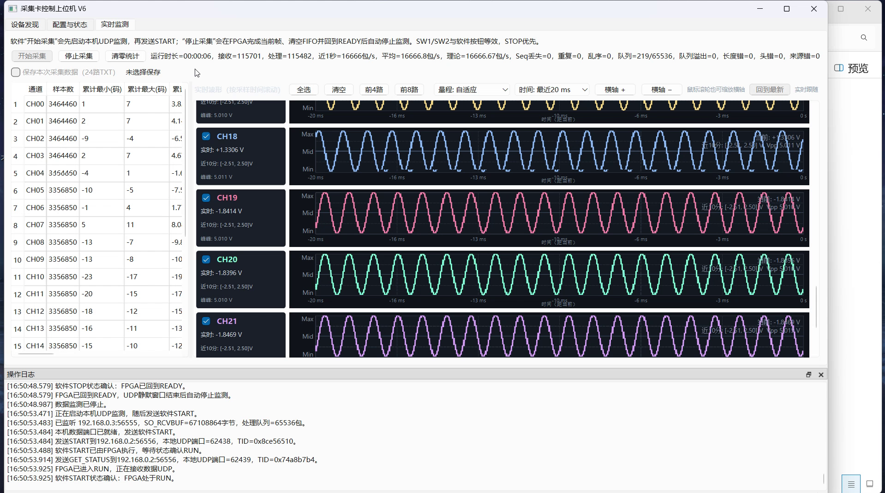

## 24路TXT记录勾选及停止过程

源录屏 12:40。

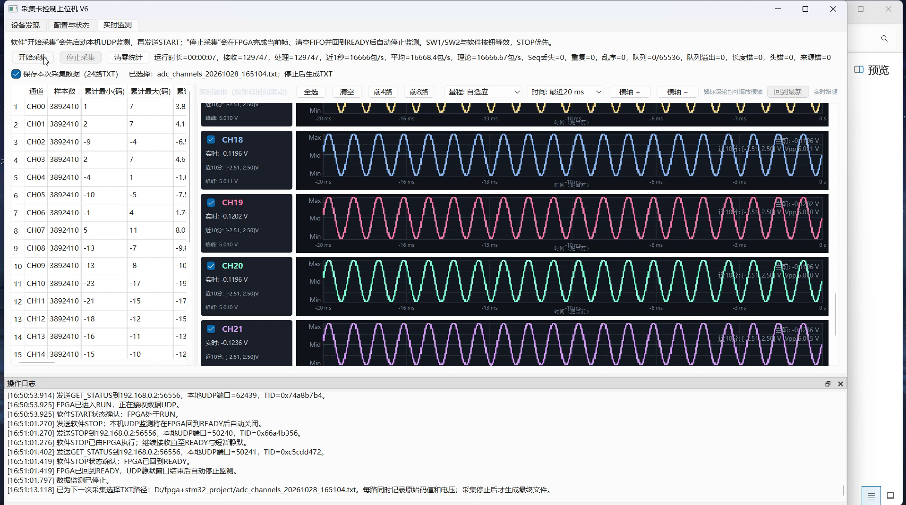

## 实际TXT文件表头/时间/码值电压

源录屏 13:20。

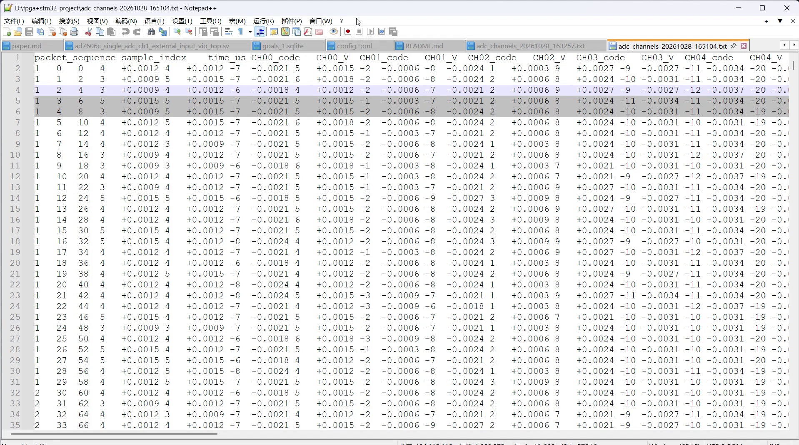

## 同一TXT横向滚动展示CH08起的数据

源录屏 13:15。

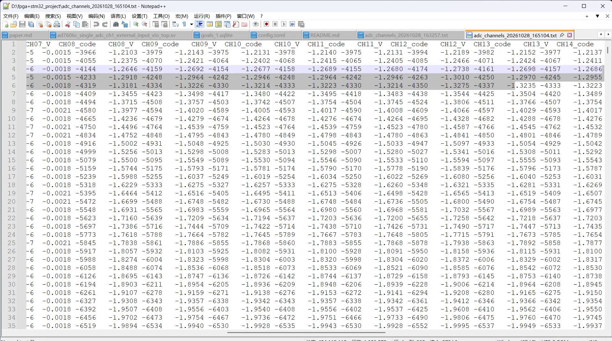

## 板端测试连接

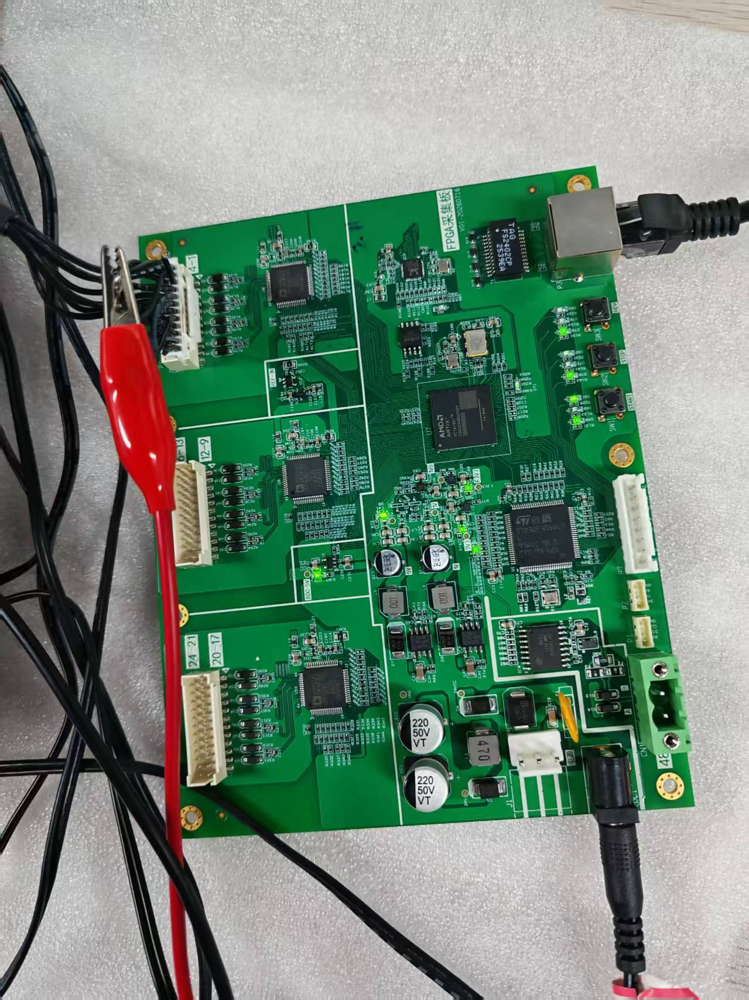

## 信号源与采集板

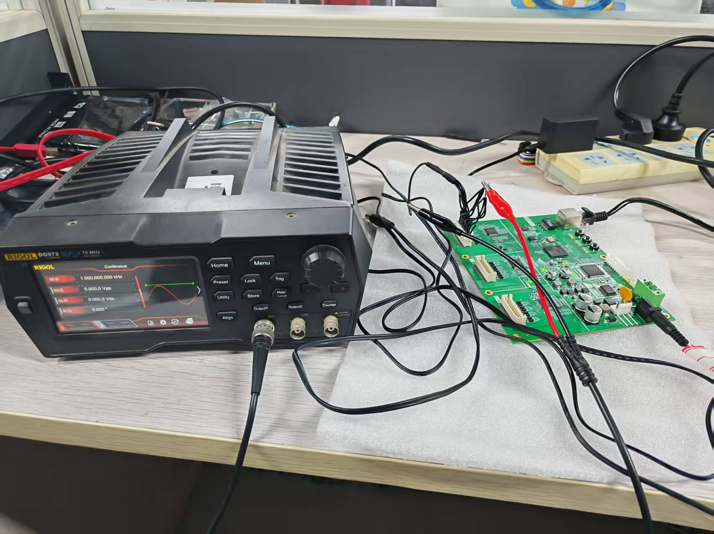
